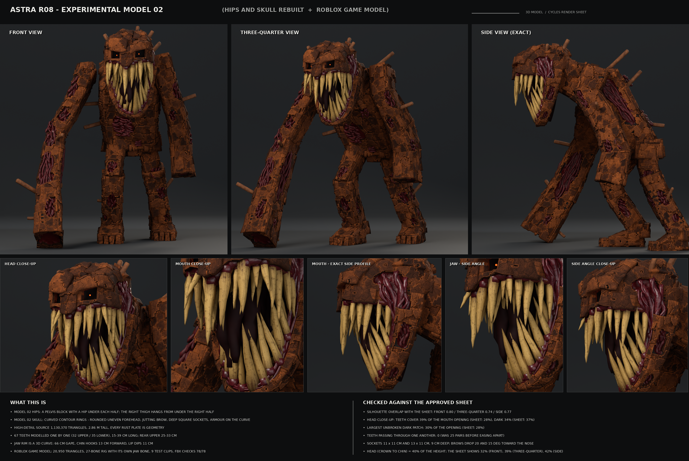
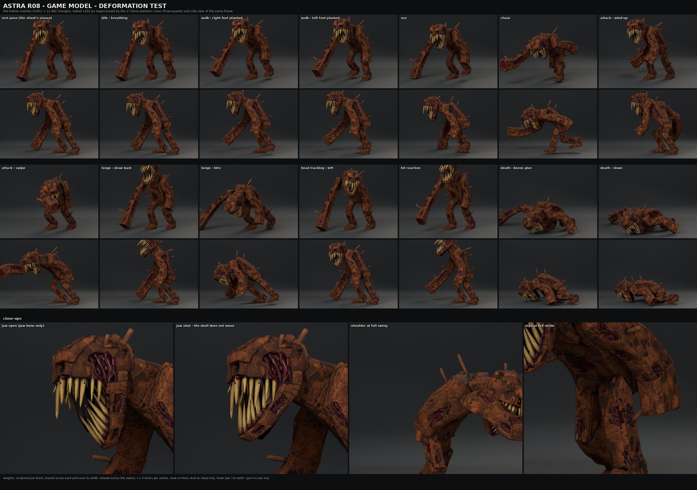

# ASTRA R08 — Experimental Model 02 (corrected anatomy + Roblox game model)

Model 02 continues Experimental Model 01 (`../experimental_01`, built from scratch from the
approved sheet `references/r08_open_jaw_sheet_v2.webp`).  It makes the two corrections asked for
and turns the creature into a rigged, animatable Roblox enemy:

1. **Right leg anatomy** — the hips are rebuilt so the creature's right thigh hangs from under
   the right half of the pelvis instead of out of the groin.
2. **Head geometry** — the skull is rebuilt as a curved, organic form instead of a flat mask on
   a block.
3. **Roblox rigging** — a 21k-triangle game model with UV maps and baked textures, a 27-bone
   skeleton with an independent jaw, eleven clips, and FBX files checked against Roblox's
   import requirements.
4. **Roblox handoff package** — [`handoff/ASTRA_R08_Roblox/`](handoff/ASTRA_R08_Roblox/README.md)
   (and `handoff/ASTRA_R08_Roblox.zip`): everything for Roblox Studio in one place, with exact import
   steps, the bone list, a controller and a test script.



## Deliverables

| Asked for | Where |
|---|---|
| 1. Complete Blender project | `model/astra_r08_exp02_game.blend` — the rigged game model: three meshes, skeleton, materials (textures from `textures/`), the eleven clips as actions.  Packaged with textures linked locally: `handoff/ASTRA_R08_Roblox/ASTRA_R08_game.blend`.  `model/astra_r08_exp02_highdetail.blend` — the high-detail source.  `src/` rebuilds both from nothing (commands below). |
| 2. Roblox-compatible FBX | `export/ASTRA_R08.fbx` (meshes + skeleton, textures embedded) and `export/animations/ASTRA_R08_<Clip>.fbx` (one clip per file).  Import steps: [docs/ROBLOX_IMPORT.md](docs/ROBLOX_IMPORT.md). |
| 3. UV maps | One UV set per mesh, inside 0–1, islands packed apart (only 0.1 % of the body's texels and 0.01 % of the head's are shared, at slivers left where blocks were united), in the .blend and the FBX.  Layouts: `textures/uv/ASTRA_R08_<Body or Head>_UV_layout.png` and `_UV_over_color.png`. |
| 4. Texture maps and materials | `textures/ASTRA_R08_<Body or Head>_<Color, Normal, Roughness, Metalness>.png` (1024 × 1024, the Roblox set); `textures/source/*_2048.png` (2048 masters, plus albedo and ambient-occlusion maps); one material per mesh. |
| 5. Optimised game geometry | Body 9,852 + Head 11,082 + Eyes 16 = **20,950 triangles** (each mesh under Roblox's 20,000), from 1,130,370 in the high-detail model. |
| 6. High-detail source retained | `model/astra_r08_exp02_highdetail.blend` (1,130,370 triangles, every rust plate modelled) — the bake source. |
| 7. Rig hierarchy reference | [docs/RIG_HIERARCHY.md](docs/RIG_HIERARCHY.md), [docs/ASTRA_R08_rig_reference.png](docs/ASTRA_R08_rig_reference.png), `analysis/game_rig.json`. |
| 8. Deformation test | `renders/game/ASTRA_R08_game_poses.png` (14 poses × 2 views + close-ups), `renders/game/ASTRA_R08_deformation_test.mp4` (all clips in sequence), `analysis/game_deformation.json` (measured). |
| Before / after | `renders/ASTRA_R08_EXP02_vs_EXP01.png` (hips and skull, Model 01 beside Model 02). |
| Against the approved sheet | `renders/ASTRA_R08_EXP02_vs_approved.png`, `renders/silhouette_check.png`; game model beside the high-detail model: `renders/game/ASTRA_R08_game_vs_highdetail.png`. |
| FBX checks | [docs/FBX_VERIFICATION.md](docs/FBX_VERIFICATION.md), `analysis/fbx_verification.json` — 116 of 116 checks passed. |
| Roblox handoff package | [handoff/ASTRA_R08_Roblox/README.md](handoff/ASTRA_R08_Roblox/README.md) — FBX, clips, textures, .blend, bone list (`rig/BONES.md`, `rig/bones.csv`), Roblox scripts (`roblox/`), checks, previews, manifest; zipped as `handoff/ASTRA_R08_Roblox.zip`. |

## Priority 1 — right leg

Model 01 put the creature's right hip 14.5 cm right of the centre line but 30 cm in front of the
hip centre and 5 cm higher than the left, on a small pelvis box: the right thigh seemed to start
at the groin.  Model 02 (`src/body.py`) rebuilds the structure rather than moving the leg:

- the torso's lower sections are widened and end in a **pelvis block** 67 cm wide, turned with
  the stride;
- a **hip block** hangs under each half of the pelvis with the hip joint at its centre — 22 cm
  either side of the pelvis centre, the right 7 cm ahead and the left 7 cm behind (the stride),
  both at the same height;
- a small **groin block** sits between the thighs, as on the sheet's front view;
- each thigh leaves the underside of its own hip block; knees, ankles and feet keep the stance
  fitted to the sheet, so the asymmetric, hunched stride is unchanged.

The silhouettes still overlap the sheet's three body panels by 0.80 (front), 0.74
(three-quarter) and 0.77 (side) — Model 01: 0.80 / 0.75 / 0.78.

## Priority 2 — skull

Model 01's face was a flat vertical mask (a 7 × 4 grid of points) with box brows on a ten-sided
cranium.  Model 02 (`src/head.py`, `build_skull`) builds the head from **ten horizontal
contours**, each a rounded outline seen from above (superellipse), stacked from the lip line to
the crown:

- the face wraps back into the temples; the forehead slopes up and back at roughly 40° into a
  rounded crown;
- a **brow ridge** stands about 3 cm proud over each socket and drops toward the nose; a **nasal
  ridge** runs down to the lip point; cheekbones jut; eight lumps and dents make every quarter
  different (the left temple is dented, the right forehead swollen);
- eleven **armour slabs** (brows, nasal plate, forehead, cheeks, temple, occiput, crown) are
  raised from the skull's own surface, so they follow its curve, and carry broader plates of
  their own; the plates of the skull wrap across its curved faces instead of stopping at every
  edge (`kernel.py`, curved-patch shell);
- the **sockets** are square windows through 4 cm of armour into black pockets about 9 cm deep.

Kept from Model 01: the socket sizes and their uneven brows, the pupil positions, the lip line
that dips to a point right of centre, the lower-jaw rim, all 67 teeth (the rear upper ones sit a
little further back, on the now-curved jaw edge) and the expression.  Mouth checks against the
sheet's head close-up: teeth cover 39 % of the opening (sheet 28 %), dark 34 % (sheet 37 %),
largest unbroken dark patch 30 % (sheet 28 %); no tooth passes through another.

## Priority 3 — the Roblox game model

Built in five scripted stages from the same blocks as the high-detail model (`src/game_*.py`):

1. **Geometry** (`game_mesh.py`).  Not a decimation of the plates: each block is cut into a
   regular quad grid (6.8 cm on the body, 4.6 cm on the head, rings round every limb), the body's
   blocks and the skull's are united into two watertight skins, and each vertex is moved to the
   height of the armour standing on it in the high-detail model, so the outline keeps the broken,
   stepped look.  The lower jaw is its own closed piece; every one of the 67 teeth is its own
   closed spike, thinned from the high-detail tooth; gum cords, cheek sinews, mouth-corner webs
   and the throat are closed tubes and slabs.  UVs are unwrapped on the flat skins (no
   stretching), the teeth and cords unrolled, all packed into 0–1 per mesh.
2. **Textures** (`game_bake.py`).  Colour, tangent-space normal (OpenGL), roughness and ambient
   occlusion are projected from the high-detail model at 2048 px (the teeth a second time from
   the teeth alone, so the black throat cannot bleed into them); the Roblox maps are 1024 px with
   part of the ambient shadow in the colour map.
3. **Skeleton and weights** (`game_rig.py`).  27 bones (Root, Pelvis, Spine, Chest, Neck, Head,
   **Jaw**; Shoulder, UpperArm, LowerArm, Wrist, Hand per arm — five bones for the very long
   arms; Hip, UpperLeg, LowerLeg, Foot, Toes per leg).  Weights are computed per block and blended
   across each joint; at most 4 bones per vertex, nothing on Root; the skull is carried by Head
   alone and the lower jaw with its teeth and gum by Jaw alone, so the mouth opens without
   bending the skull.  Units converted to studs.
4. **Clips** (`game_anim.py`).  Idle, Walk, Run, Chase, Attack, Lunge, HitReact, Death (full
   body), JawSnap and JawChatter (Jaw bone only) and HeadTrack (Neck and Head only) — in place,
   30 fps, feet planted by a two-bone solver, limbs kept out of the floor.  The partial clips layer
   over the full-body ones in Roblox.  They prove the rig; they are not finished animation.
5. **Export and verification** (`game_export.py`).  Roblox's Blender settings (Unit System None,
   FBX Unit Scale, Z Forward, Y Up, Path Mode Copy + Embed Textures, no leaf bones, one clip per
   file).  Every file is then read back three ways — the raw FBX structure, Blender's Python
   importer and Blender's C++ importer (ufbx) — and compared with the source: geometry, UVs,
   weights and skeleton identical to within 0.000003 studs; every clip file carries the same
   skeleton and bind pose; every clip played from its own file on the re-imported rig matches the
   source to 0.0 mm; textures linked on the right channels; root at the origin, facing -Z.
6. **Handoff** (`handoff.py`).  Assembles `handoff/ASTRA_R08_Roblox/` and its zip, re-saving the
   .blend with package-relative texture links and checking the package's own files.

| Game model | |
|---|---|
| Height | 10.30 studs (2.885 m), soles on the ground plane, facing -Z |
| Triangles | Body 9,852 · Head 11,082 · Eyes 16 |
| Bones | 27; ≤ 4 per vertex (mean 1.94 body, 1.12 head) |
| Textures | 4 maps × 2 meshes, 1024 px, embedded in the FBX |
| Deformation (largest edge stretch in each clip) | Idle 1.10 · Walk 1.78 · Run 2.02 · Chase 2.11 · Attack 2.39 (right armpit, top of the swing) · Lunge 1.58 · HitReact 1.40 · Death 2.04 · JawSnap 1.32 · JawChatter 1.16 · HeadTrack 1.64 |
| Skull and lower jaw | rigid to 0.001 mm in every clip |



## Not done / known limits

- **Roblox Studio was not available** in the build container (Linux).  The FBX files meet
  Roblox's documented requirements and survive two independent importers exactly, but they have
  not been opened in Studio's 3D Importer or Animation Editor.  [docs/ROBLOX_IMPORT.md](docs/ROBLOX_IMPORT.md)
  lists the import settings and what to check.
- Linear-blend skinning (all Roblox offers): the inside of a tightly bent joint folds flat (the
  elbow in Death), and the right armpit stretches up to 2.4 × at the top of the attack swing.
- The game model's plates are in its maps and a coarse relief (about ±4 cm) of its outline; the
  individual stepped slabs exist only in the high-detail model.  The thin strands that twist
  round each cheek sinew are texture only.
- The clips are test animation, in place; the Roblox scripts in `roblox/` are syntax-checked
  but have not run in Studio.
- Proportions are the same compromise as Model 01 (the sheet's panels disagree with one another
  on the head's size: 32 / 39 / 42 % of the height; the model has 40 %).

## Rebuilding

```bash
bvenv/bin/python experimental_02/src/build.py
```

```bash
bvenv/bin/python experimental_02/src/game_mesh.py
```

```bash
BAKE_RES=2048 bvenv/bin/python experimental_02/src/game_bake.py
```

```bash
bvenv/bin/python experimental_02/src/game_rig.py && bvenv/bin/python experimental_02/src/game_anim.py
```

```bash
bvenv/bin/python experimental_02/src/game_export.py
```

```bash
bvenv/bin/python experimental_02/src/game_preview.py poses
```

```bash
bvenv/bin/python experimental_02/src/handoff.py
```

The high-detail build takes about 8 s, the game mesh 15 s, the bake about 22 minutes on four
CPU cores, rig + clips + export + all checks under a minute.  `game_preview.py` also takes
`clip`, `compare`, `rig`, `uv` and `stats`.  The high-detail renders and sheets are made as in
Model 01 (`render.py`, `make_sheets.py`, `report.py`); `changes_sheet.py` makes the before / after
sheet (it uses Model 01 renders of the extra skull views in `renders/model01_views`, rendered from
`experimental_01/model/astra_r08_exp01.blend` with this model's `render.py`).
