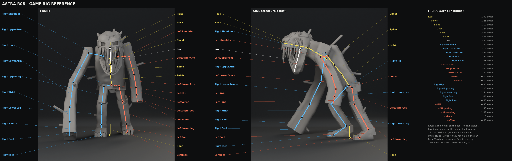

# ASTRA R08 game rig - hierarchy reference



One armature, **27 bones**, carrying three meshes (`ASTRA_R08_Body`, `ASTRA_R08_Head`, `ASTRA_R08_Eyes`).
"Right" and "Left" are the creature's own sides (its very long arm is the right one).
Source: `src/game_rig.py`; numbers: `analysis/game_rig.json`, `analysis/game_weights.json`.

## Hierarchy

```
Root
    Pelvis
        Spine
            Chest
                Neck
                    Head
                        Jaw
                RightShoulder
                    RightUpperArm
                        RightLowerArm
                            RightWrist
                                RightHand
                LeftShoulder
                    LeftUpperArm
                        LeftLowerArm
                            LeftWrist
                                LeftHand
        RightHip
            RightUpperLeg
                RightLowerLeg
                    RightFoot
                        RightToes
        LeftHip
            LeftUpperLeg
                LeftLowerLeg
                    LeftFoot
                        LeftToes
```

## Bones

Positions are the bone's head (joint) in **studs**, in the FBX file's and Studio's frame: X = the
creature's right, Y = up, Z = backwards (the creature faces -Z, Roblox's front).  In the Blender file
the same bone sits at (-X, Z, Y) (Blender: Z up, the creature faces -Y).  "Vertices" = vertices with
any weight on the bone.

| Bone | Parent | Head position (studs) | Length (studs) | Vertices | Carries |
|---|---|---|---|---|---|
| Root | - | (-0.00, 0.00, 0.00) | 1.07 | 0 | nothing (no skin weight, as Roblox requires); the top of the hierarchy, on the floor at the origin |
| Pelvis | Root | (-0.13, 4.95, -0.06) | 1.25 | 987 | the bottom of the torso, the pelvis block, the groin block |
| Spine | Pelvis | (-0.02, 6.00, -0.72) | 1.17 | 565 | the middle of the torso |
| Chest | Spine | (-0.02, 6.91, -1.46) | 1.24 | 762 | the hunched upper torso (its top corners shared with the shoulders), the rods in the back and flank |
| Neck | Chest | (-0.02, 7.50, -2.21) | 2.04 | 430 | the neck block (shared with Chest at its base and Head at its top) |
| Head | Neck | (0.04, 8.55, -3.95) | 2.35 | 4,196 | the whole skull with its armour slabs, sockets, hinge and occiput blocks, the 32 upper teeth, the upper gum, the pupils |
| Jaw | Head | (0.03, 8.38, -4.66) | 2.20 | 2,337 | the lower jaw block, its 35 teeth and the gum band - rigidly; the cheek sinews, mouth-corner webs and throat stretch between Jaw and Head |
| RightShoulder | Chest | (0.70, 7.76, -2.05) | 1.42 | 225 | the right top corner of the chest and the start of the long arm |
| RightUpperArm | RightShoulder | (2.07, 8.04, -2.29) | 3.14 | 433 | the long arm from the shoulder to the elbow |
| RightLowerArm | RightUpperArm | (3.50, 5.27, -2.71) | 2.55 | 389 | the long arm from the elbow to the forearm bend |
| RightWrist | RightLowerArm | (3.77, 2.98, -3.80) | 1.54 | 280 | the thick forearm |
| RightHand | RightWrist | (3.74, 1.67, -4.60) | 1.43 | 283 | the blunt, hollow-looking end that rests on the floor; the rods near it |
| LeftShoulder | Chest | (-0.73, 7.76, -2.05) | 1.25 | 357 | the left top corner of the chest and the start of the short arm |
| LeftUpperArm | LeftShoulder | (-1.77, 7.64, -2.75) | 2.02 | 324 | the short arm from the shoulder to the elbow |
| LeftLowerArm | LeftUpperArm | (-2.27, 5.96, -1.75) | 1.32 | 202 | the short forearm |
| LeftWrist | LeftLowerArm | (-2.48, 4.73, -1.34) | 0.72 | 139 | the end of the short forearm |
| LeftHand | LeftWrist | (-2.54, 4.03, -1.48) | 0.72 | 129 | the blunt end of the short arm |
| RightHip | Pelvis | (-0.13, 4.95, -0.06) | 0.80 | 325 | the right hip block under the right half of the pelvis (its underside shared with the thigh) |
| RightUpperLeg | RightHip | (0.61, 4.79, -0.30) | 2.20 | 446 | the right thigh |
| RightLowerLeg | RightUpperLeg | (0.80, 3.12, -1.73) | 2.54 | 443 | the right shin, its knee and the ankle block |
| RightFoot | RightLowerLeg | (0.86, 1.04, -0.29) | 1.46 | 501 | the right foot block |
| RightToes | RightFoot | (0.93, 0.18, -1.46) | 0.61 | 256 | the four right toe blocks and the front of the foot |
| LeftHip | Pelvis | (-0.13, 4.95, -0.06) | 0.80 | 354 | the left hip block under the left half of the pelvis |
| LeftUpperLeg | LeftHip | (-0.88, 4.79, 0.18) | 1.57 | 418 | the left thigh |
| LeftLowerLeg | LeftUpperLeg | (-1.21, 3.27, 0.39) | 2.68 | 453 | the left shin, its knee and the ankle block |
| LeftFoot | LeftLowerLeg | (-1.62, 0.95, 1.66) | 1.10 | 460 | the left foot block |
| LeftToes | LeftFoot | (-1.70, 0.18, 0.88) | 0.61 | 262 | the four left toe blocks and the front of the foot |

## Conventions

- **Units**: studs (1 stud = 0.28 m).  The creature stands 10.30 studs (2.885 m) tall; the soles
  rest on Y = 0 and Root sits at the origin.
- **Rest pose** = the approved sheet's stance (hunched, long right arm hanging to the floor, right
  leg striding forward).  Animations are stored as rotations from this pose.
- **Bone axes** (as authored in Blender, FBX primary axis Y, secondary X): every bone's local Y
  runs from its head to its tail; on every bone that is not itself sideways its local X points to
  the creature's left, so "rotate about X" is the forward / backward bend of that joint, "about
  Z" the sideways swing and "about Y" the twist.  The two shoulder and two hip bones run sideways;
  they keep local Z pointing up instead.
- **No leaf bones**, no IK or constraint bones: everything in the hierarchy deforms or is the root,
  so the skeleton Roblox reads is exactly this one.
- **Jaw**: its own bone, hinged at the back corners of the mouth (head at the middle of the hinge
  line, tail at the chin).  Rotating it about its X axis opens and closes the mouth; the skull does
  not move (measured: skull and lower-jaw vertices stay within 0.001 mm of rigid in every test
  clip, `analysis/game_deformation.json`).
- **Head tracking**: turn `Neck` and `Head` (about Z to look left / right, about X to look up /
  down); `HeadTrack` shows the range used in testing (head 30 degrees either side, 18-20 degrees up and down).

## Skin weights

Computed, not painted (`src/game_rig.py`):

- each block of the body belongs to a chain of bones (torso: Pelvis > Spine > Chest; long arm:
  RightShoulder > RightUpperArm > RightLowerArm > RightWrist > RightHand; ...), and a vertex is
  shared between two neighbouring bones of its chain across a zone centred on their joint, as
  wide as the joint (smoothstep);
- where two blocks were united (thigh into hip block, neck into chest, arm into shoulder) the
  weights are averaged across the seam over a few rings of vertices, so no edge joins two
  vertices that follow different bones outright;
- the rods move rigidly with the block they are driven into;
- at most 4 bones per vertex (body: mean 1.94; head: mean 1.12), every vertex weighted, weights
  sum to 1, nothing on Root;
- head mesh: 3,396 vertices on Head alone, 1,674 on Jaw alone, 663 shared (the sinews, webs and
  throat that must stretch when the mouth moves); eyes on Head alone.

## Test animations

| Clip | Frames (30 fps) | Loops | File |
|---|---|---|---|
| Idle | 91 | yes | `export/animations/ASTRA_R08_Idle.fbx` |
| Walk | 31 | yes | `export/animations/ASTRA_R08_Walk.fbx` |
| Run (chase) | 19 | yes | `export/animations/ASTRA_R08_Run.fbx` |
| Attack (long-arm swipe) | 37 | no | `export/animations/ASTRA_R08_Attack.fbx` |
| Lunge (bite) | 34 | no | `export/animations/ASTRA_R08_Lunge.fbx` |
| HeadTrack | 103 | no | `export/animations/ASTRA_R08_HeadTrack.fbx` |
| JawSnap | 31 | no | `export/animations/ASTRA_R08_JawSnap.fbx` |
| HitReact | 19 | no | `export/animations/ASTRA_R08_HitReact.fbx` |
| Death | 61 | no | `export/animations/ASTRA_R08_Death.fbx` |

All in place (no root motion), keyed every second frame in Blender and baked to every frame in
the FBX.  The feet are planted by a two-bone solver in Walk and Run, and arms (and in Lunge and
Death the head) are laid on the floor rather than through it.  They are tests of the rig, not
finished animation.
