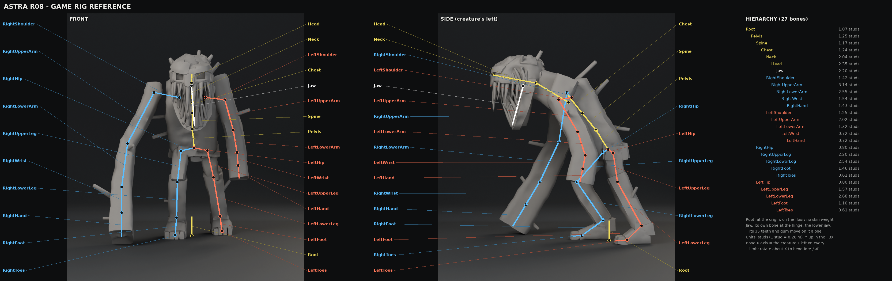

# ASTRA R08 - bones

27 bones in one hierarchy; every mesh (`ASTRA_R08_Body`, `ASTRA_R08_Head`, `ASTRA_R08_Eyes`) is skinned to it.
"Right" / "Left" are the creature's own sides - its very long arm is the right one.



## Hierarchy

```
Root
    Pelvis
        Spine
            Chest
                Neck
                    Head
                        Jaw
                RightShoulder
                    RightUpperArm
                        RightLowerArm
                            RightWrist
                                RightHand
                LeftShoulder
                    LeftUpperArm
                        LeftLowerArm
                            LeftWrist
                                LeftHand
        RightHip
            RightUpperLeg
                RightLowerLeg
                    RightFoot
                        RightToes
        LeftHip
            LeftUpperLeg
                LeftLowerLeg
                    LeftFoot
                        LeftToes
```

## Bones

Head (joint) and length in **studs**, in the frame of the FBX file and of Studio after import with the
settings in the README: X = the creature's right, Y = up, Z = toward its back (the creature faces -Z).
Vertices = vertices with any weight on the bone (all three meshes).

| # | Bone | Parent | Head position (studs) | Length (studs) | Vertices | Carries |
|---|---|---|---|---|---|---|
| 1 | `Root` | - | (-0.00, 0.00, 0.00) | 1.07 | 0 | nothing (no skin weight, as Roblox requires); top of the hierarchy, on the ground at the origin |
| 2 | `Pelvis` | `Root` | (-0.13, 4.95, -0.06) | 1.25 | 987 | bottom of the torso, pelvis block, groin block |
| 3 | `Spine` | `Pelvis` | (-0.02, 6.00, -0.72) | 1.17 | 565 | middle of the torso |
| 4 | `Chest` | `Spine` | (-0.02, 6.91, -1.46) | 1.24 | 762 | hunched upper torso (top corners shared with the shoulders), rods in the back and flank |
| 5 | `Neck` | `Chest` | (-0.02, 7.50, -2.21) | 2.04 | 430 | neck block (shared with Chest at its base, Head at its top) |
| 6 | `Head` | `Neck` | (0.04, 8.55, -3.95) | 2.35 | 4,208 | skull with its armour slabs, sockets and hinge blocks; the 32 upper teeth; upper gum; eyes |
| 7 | `Jaw` | `Head` | (0.03, 8.38, -4.66) | 2.20 | 2,337 | lower jaw, its 35 teeth and the gum band (rigidly); shares the cheek sinews, mouth webs and throat with Head |
| 8 | `RightShoulder` | `Chest` | (0.70, 7.76, -2.05) | 1.42 | 225 | right top corner of the chest, start of the long arm |
| 9 | `RightUpperArm` | `RightShoulder` | (2.07, 8.04, -2.29) | 3.14 | 433 | long arm, shoulder to elbow |
| 10 | `RightLowerArm` | `RightUpperArm` | (3.50, 5.27, -2.71) | 2.55 | 389 | long arm, elbow to forearm bend |
| 11 | `RightWrist` | `RightLowerArm` | (3.77, 2.98, -3.80) | 1.54 | 280 | thick forearm |
| 12 | `RightHand` | `RightWrist` | (3.74, 1.67, -4.60) | 1.43 | 283 | blunt hollow end resting on the floor |
| 13 | `LeftShoulder` | `Chest` | (-0.73, 7.76, -2.05) | 1.25 | 357 | left top corner of the chest, start of the short arm |
| 14 | `LeftUpperArm` | `LeftShoulder` | (-1.77, 7.64, -2.75) | 2.02 | 324 | short arm, shoulder to elbow |
| 15 | `LeftLowerArm` | `LeftUpperArm` | (-2.27, 5.96, -1.75) | 1.32 | 202 | short forearm |
| 16 | `LeftWrist` | `LeftLowerArm` | (-2.48, 4.73, -1.34) | 0.72 | 139 | end of the short forearm |
| 17 | `LeftHand` | `LeftWrist` | (-2.54, 4.03, -1.48) | 0.72 | 129 | blunt end of the short arm |
| 18 | `RightHip` | `Pelvis` | (-0.13, 4.95, -0.06) | 0.80 | 325 | right hip block under the right half of the pelvis |
| 19 | `RightUpperLeg` | `RightHip` | (0.61, 4.79, -0.30) | 2.20 | 446 | right thigh |
| 20 | `RightLowerLeg` | `RightUpperLeg` | (0.80, 3.12, -1.73) | 2.54 | 443 | right shin, knee and ankle block |
| 21 | `RightFoot` | `RightLowerLeg` | (0.86, 1.04, -0.29) | 1.46 | 501 | right foot block |
| 22 | `RightToes` | `RightFoot` | (0.93, 0.18, -1.46) | 0.61 | 256 | four right toe blocks |
| 23 | `LeftHip` | `Pelvis` | (-0.13, 4.95, -0.06) | 0.80 | 354 | left hip block under the left half of the pelvis |
| 24 | `LeftUpperLeg` | `LeftHip` | (-0.88, 4.79, 0.18) | 1.57 | 418 | left thigh |
| 25 | `LeftLowerLeg` | `LeftUpperLeg` | (-1.21, 3.27, 0.39) | 2.68 | 453 | left shin, knee and ankle block |
| 26 | `LeftFoot` | `LeftLowerLeg` | (-1.62, 0.95, 1.66) | 1.10 | 460 | left foot block |
| 27 | `LeftToes` | `LeftFoot` | (-1.70, 0.18, 0.88) | 0.61 | 262 | four left toe blocks |

The same table as CSV: `bones.csv`.

## Notes for animating

- **Root** sits on the ground at the origin and carries no weight.  The clips key it but never move it
  (in place, no root motion): move the model itself in the game.
- **Jaw** is a bone of its own at the hinge (head at the middle of the hinge line, tail at the chin); the
  lower jaw, its 35 teeth and its gum follow it rigidly, the skull does not move (measured to 0.001 mm).
  Opening = rotating it about the creature's left-right axis; useful range from 21 degrees shut to 16
  degrees wider than the rest pose (the rest pose is the sheet's open mouth).
- **Neck + Head** turn the head; the test clip HeadTrack uses up to 52 degrees left / right (22 neck + 30
  head) and about 34 up / 30 down.
- Each arm has five bones (Shoulder, UpperArm, LowerArm, Wrist, Hand) for the very long arms; each leg
  five (Hip, UpperLeg, LowerLeg, Foot, Toes).
- In Blender every bone's local Y runs along it and, except on the sideways Shoulder and Hip bones,
  its local X points to the creature's left.  Studio may express bone axes differently after import;
  the controller script in `roblox/` works in world space so it does not depend on them.
